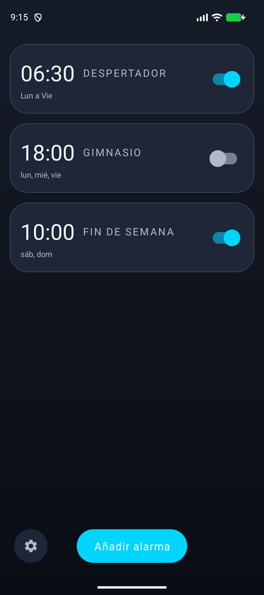
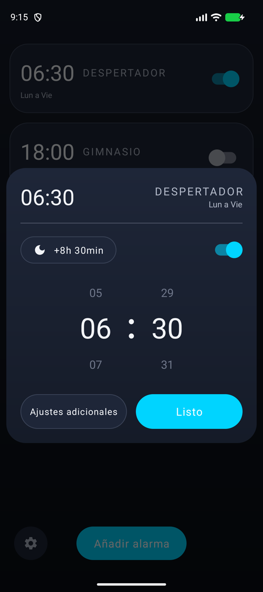
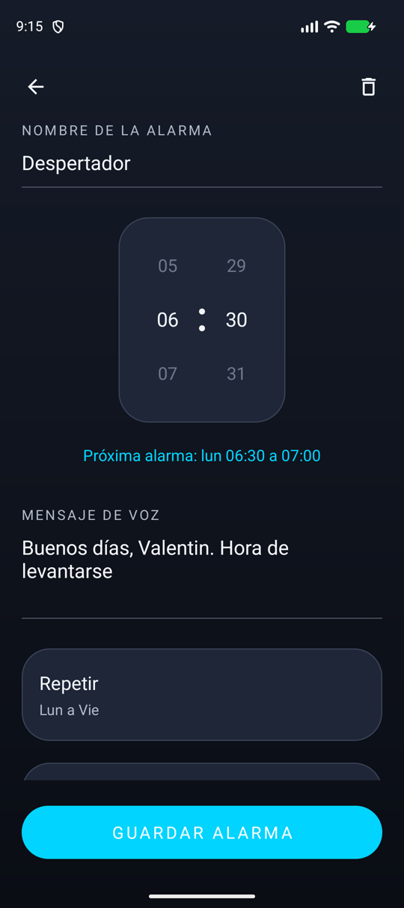
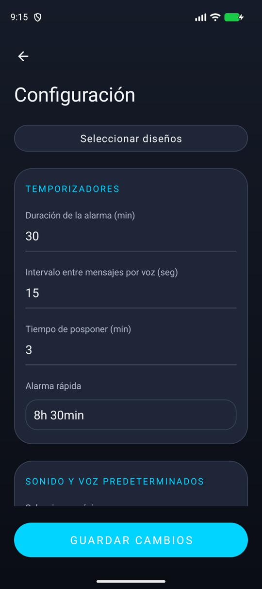
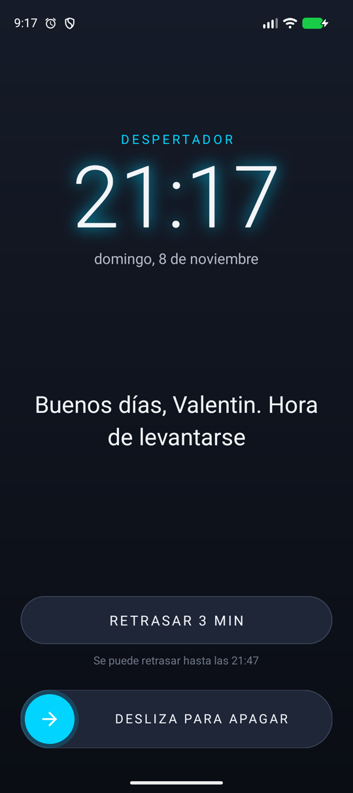

# VoiceAlarm

Un despertador para Android que te habla. A la hora de la alarma empieza una canción tranquila y, por encima, una voz dice el mensaje que hayas escrito ("Buenos días, Valentin. Hora de levantarse") cada pocos segundos hasta que la apagas.

La idea es despertarse con algo más amable que un pitido, pero que no se pueda ignorar: la música es suave, la voz te recuerda para qué pusiste la alarma y, pasado un tiempo, ya no deja seguir retrasándola.

  
  
  
  
  

## Qué hace

- Cada alarma tiene su nombre, sus días, su mensaje de voz, su música y una o varias voces. Con varias voces, cada mensaje lo dice una distinta.
- La primera frase suena exactamente un segundo después de que empiece la música, y la música baja poco a poco mientras habla la voz para que se entienda.
- Se puede retrasar las veces que quieras dentro de un margen (por ejemplo de 6:00 a 6:30). Pasado ese límite deja de poder retrasarse y suena sin parar hasta que la apagas deslizando, para no apagarla medio dormido.
- "Alarma rápida": con un toque, la alarma suena dentro de 8 h 30 min solo esa vez y luego vuelve a su horario normal.
- Agitar el móvil la retrasa, y aparece a pantalla completa aunque el teléfono esté bloqueado.
- Ocho temas de color.

## Cómo está hecha

Java con el sistema de vistas de Android (pantallas en XML) y AppCompat como única librería. Lo que no existe tal cual en Android está dibujado a mano como vistas propias: la rueda de la hora que gira sin fin con su inercia, el interruptor, los deslizadores de volumen y el control de deslizar para apagar. Los ocho temas de color se aplican desde el código, así que cambiar de diseño no obliga a duplicar ningún XML.

**Que la alarma suene sí o sí.** Se programa con `AlarmManager.setAlarmClock`, la única forma que Android respeta aunque el móvil esté en reposo profundo. Al sonar arranca un servicio en primer plano que mantiene el móvil despierto, y una notificación a pantalla completa abre la alarma encima de la pantalla de bloqueo. Al encender el móvil o cambiar la hora, todas las alarmas se vuelven a programar. El sonido va por el canal de alarma, que el modo silencio no apaga, y mientras suena la app pone ese volumen al máximo y lo vuelve a subir cada segundo si alguien lo baja, así que se oye aunque el móvil esté bajado del todo. Lo fuerte que suena se elige con los volúmenes de la propia app. Al apagarla, el volumen del móvil vuelve a como estaba, y el valor anterior se guarda en disco por si la app se cerrara de golpe mientras suena.

**La voz, justo al segundo.** El motor de voz de Android tarda entre uno y tres segundos en arrancar, así que pedirle que hable al segundo no basta. La app graba cada mensaje con cada voz elegida en el momento en que guardas la alarma (`synthesizeToFile`). Al sonar, la grabación ya está cargada en un reproductor y solo hay que darle al play. Todo el audio va en un hilo propio para que abrir la pantalla de la alarma no lo retrase. Medido: 1,00 s entre la música y la voz, frente a casi 3 s hablando en directo. Si faltara una grabación, la app usa el motor de voz en directo.

**Música clásica de despertar, sin problemas de licencia.** Las canciones son piezas tranquilas como "La mañana" de Grieg, "Clair de lune" de Debussy o la "Gymnopédie nº 1" de Satie, en grabaciones de dominio público o CC0 de Wikimedia Commons, y música de fondo de meditación con licencias libres, así que se pueden incluir en una app pública. De cada una se toma un fragmento de dos minutos y medio, sin el silencio inicial, con un final suave para que el bucle no corte de golpe y con el volumen igualado entre todas. Debajo aparecen los tonos de alarma del propio teléfono, leídos con `RingtoneManager`, para quien prefiera un despertador de toda la vida.

**Datos.** Las alarmas y los ajustes se guardan como JSON en las preferencias de la app. Son pocos datos y no hace falta una base de datos.

## Créditos

Música: grabaciones de dominio público y CC0 de [Wikimedia Commons](https://commons.wikimedia.org/) (Musopen y otros intérpretes), elegidas a partir del catálogo de [QuietRingtones](https://github.com/Quiet115/QuietRingtones-catalog).

Música de meditación: "Deep Relaxation", "Elf Meditation", "Ancient Winds", "Wind of the Rainforest", "Ebbs and Flows" y "River Meditation" de [FreePD](https://freepd.com/) (CC0); "Jade Pillow" de Joey Bond (CC0); y "Meditation Impromptu 01, 02 y 03", "Organic Meditations One y Three" y "Relaxing Piano Music" de Kevin MacLeod ([incompetech.com](https://incompetech.com/)), con licencia [CC BY 3.0](https://creativecommons.org/licenses/by/3.0/).
